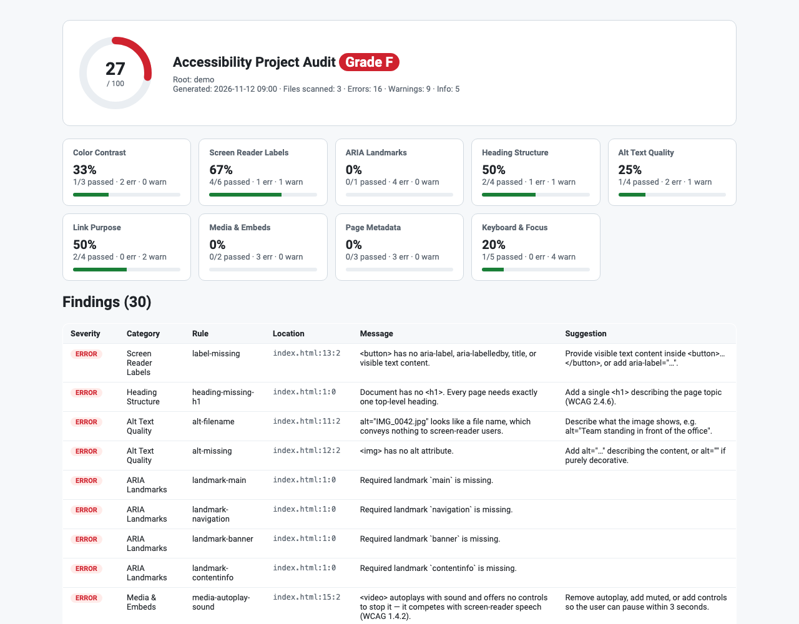

# Accessibility Compliance Helper — WCAG Audit

Open-source accessibility auditor for Visual Studio Code by Jakub Jirák. It checks HTML, JSX/TSX,
Vue, Svelte, Razor and CSS/SCSS/LESS against WCAG 2.2 while you type. It shows findings in the
Problems panel, offers quick fixes, and scores the whole workspace with a 0–100 health score that you
can export as Markdown, JSON, HTML or SARIF.

Everything runs locally. There are no network calls, no telemetry and no runtime dependencies, and it
works in Restricted Mode (untrusted workspaces).



## Features

- **Live diagnostics** in the Problems panel for `.html .htm .xhtml .jsx .tsx .vue .svelte .razor .cshtml .css .scss .sass .less`,
  refreshed as you type (debounced) or on save. Each diagnostic carries a stable rule id that links
  to the relevant WCAG *Understanding* page.
- **Quick fixes** (`Ctrl+.` / `Cmd+.`):
  - add `alt=""` to images without `alt`
  - add `aria-label` to unnamed controls and empty links
  - add `title` to iframes
  - add `lang="en"` to `<html>`
  - turn a positive `tabindex` into `0`
  - remove `autofocus`
- **Workspace audit** (`Accessibility: Run Workspace Accessibility Audit`) runs all nine auditors.
  It produces a report with a 0–100 health score, a letter grade (A–F), per-category pass rates and
  a findings table; click a location to jump to the code. The results also fill the Problems panel.
- **Export** (`Accessibility: Export Workspace Audit Report…`) saves the report as Markdown (for PRs
  and tickets), self-contained HTML, **SARIF 2.1.0** (for GitHub Code Scanning or Azure DevOps) or
  JSON.
- **Template-aware parsing.** One shared tokenizer handles:
  - JSX expressions, spreads (`{...props}`) and Vue, Svelte and Angular bindings
  - Razor and JSX comments
  - unquoted attributes, legacy uppercase HTML and optional end tags
  - hidden subtrees and character references

  Values decided at runtime (`alt={label}`, `:aria-label`, `muted={isMuted}`) are treated as unknown,
  not reported as missing.

## Auditors and rules

| Category | WCAG | Rules |
|---|---|---|
| **Color Contrast** | 1.4.3, 1.4.11 | `contrast-text`, `contrast-non-text`: CSS/SCSS/LESS rules, `<style>` blocks and inline styles, with large-text thresholds |
| **Screen Reader Labels** | 4.1.2 | `label-missing`, `label-placeholder-only`: WAI-ARIA accessible-name computation (`aria-labelledby`, `aria-label`, `<label for>`, wrapping labels, text, `alt`, `title`, `value`) |
| **ARIA Landmarks** | 1.3.1, 2.4.1 | `landmark-main`, `landmark-banner`, `landmark-contentinfo`, `landmark-navigation` and more: required landmarks, duplicates without unique names. Full documents only, so component fragments stay quiet |
| **Heading Structure** | 1.3.1, 2.4.6 | `heading-missing-h1`, `heading-multiple-h1`, `heading-skipped-level`, `heading-empty`, `heading-too-long`, `heading-role-without-aria-level`, `heading-invalid-aria-level` |
| **Alt Text Quality** | 1.1.1 | `alt-missing`, `alt-filename`, `alt-placeholder`, `alt-redundant-phrase`, `alt-too-long`, `alt-whitespace-only`, `alt-decorative-conflict`, `alt-title-duplicate`, `svg-img-missing-name`, `svg-unmarked` |
| **Link Purpose** | 2.4.4, 3.2.5, 2.1.1 | `link-empty`, `link-placeholder-href`, `link-no-href-clickable`; advisory: `link-generic-text`, `link-url-as-text`, `link-new-window-unannounced`, `link-ambiguous-duplicate` |
| **Media & Embeds** | 1.2.2, 1.4.2, 4.1.2, 1.1.1 | `media-video-no-captions`, `media-autoplay-sound`, `media-no-controls`, `media-iframe-no-title`, `media-embed-no-alternative`, `media-track-no-srclang` |
| **Page Metadata** | 3.1.1, 2.4.2, 1.4.4, 2.2.1, 1.3.1 | `doc-missing-lang`, `doc-invalid-lang`, `doc-missing-title`, `doc-empty-title`, `doc-viewport-zoom-blocked`, `doc-meta-refresh`, `doc-duplicate-id`, `doc-duplicate-accesskey` |
| **Keyboard & Focus** | 2.1.1, 2.4.3, 2.4.7, 3.2.1 | `focus-positive-tabindex`, `focus-click-not-focusable`, `focus-click-no-role`, `focus-click-no-key-handler`, `focus-autofocus`, `focus-outline-suppressed` (structural CSS parser that accepts `:focus-visible` replacements) |

**Health score.** For each category, the pass rate is the share of checked items with no error or
warning. The health score is the rounded mean of those pass rates, counting only categories that had
something to check. Advisory (INFO) findings never lower the score.

## Settings

| Setting | Default | Description |
|---|---|---|
| `a11yHelper.enable` | `true` | Show live diagnostics for open files |
| `a11yHelper.run` | `onType` | `onType` (debounced) or `onSave` |
| `a11yHelper.showAdvisory` | `true` | Show advisory (INFO) findings |
| `a11yHelper.rules.contrast` … `a11yHelper.rules.focus` | `true` | Turn each of the nine rule groups on or off (`contrast`, `labels`, `landmarks`, `headings`, `altText`, `links`, `media`, `document`, `focus`) |
| `a11yHelper.audit.exclude` | `[]` | Extra glob patterns excluded from the workspace audit. `node_modules`, `dist`, `build`, `.git` and similar folders are always skipped |
| `a11yHelper.audit.maxFileSizeKB` | `2000` | Skip larger files |

## Commands

- `Accessibility: Run Workspace Accessibility Audit`
- `Accessibility: Audit Current File`
- `Accessibility: Export Workspace Audit Report…`
- `Accessibility: Clear Accessibility Diagnostics`

## Limitations

Static analysis cannot replace testing with real assistive technology. Contrast is checked only where
both colors can be resolved from the same rule or element. Landmark analysis applies only to full
documents (`<html>` or `<body>` present).

## Development

```bash
npm ci
npm test          # vitest — vscode-free core in src/core
npm run lint
npm run typecheck
npm run vsix      # builds the .vsix
npm run icon      # regenerates media/icon.png
node scripts/gen-screenshot.mjs   # regenerates the README screenshot from demo/
```

## License

[Apache License 2.0](LICENSE) © 2026 Jakub Jirák
